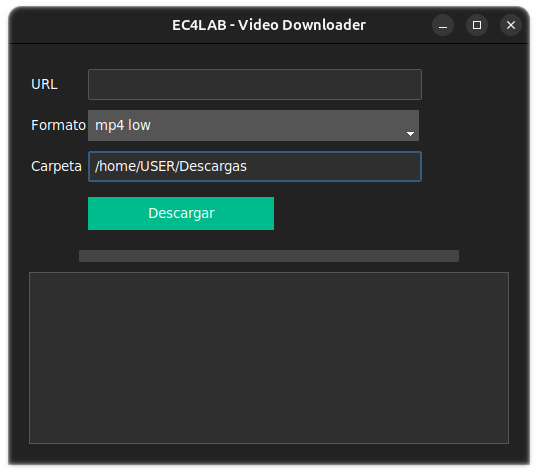
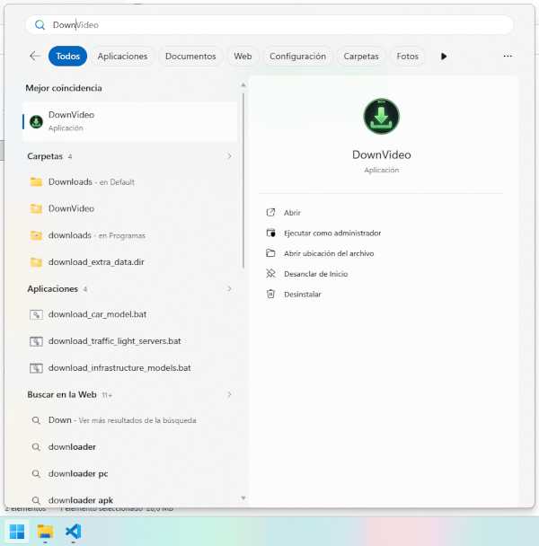
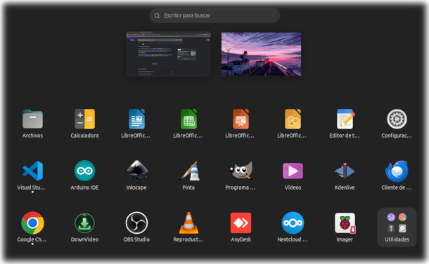

# Descargar Videos

Programa en python para descargar videos de la web, en formato mp4 o solo el audio en mp3.

Funciona directamente desde python o se pueden crear los ejecutables.

Basado en la librería [yt-dlp](<https://github.com/yt-dlp/yt-dlp>), con una interfaz gráfica muy simple creada con [ttkbootstrap](<https://ttkbootstrap.readthedocs.io/en/latest/>)



Comprobado con `YouTube`, `YouTubeMusic`, `Instagram` (si el video es público) y `TikTok`, la [documentación](<https://github.com/yt-dlp/yt-dlp/blob/master/supportedsites.md>) de la librería indica muchas otras compatibilidades, pero no pude probarlas aún.

Admite videos individuales o listas de reproducción en ese caso enumera como 001, 002,...

Por defecto las descargas se hacen en la carpeta genérica de `Descargas` (se adapta según el sistema operativo), sino, se puede editar el campo.

## Instalación

```bash
git clone https://github.com/ec4lab/DescargarVideos.git
```

Ir a la carpeta el proyecto

```bash
cd DescargarVideos
```

Crear entorno virtual

```bash
python3 -m venv .venv # En Ubuntu  
python -m venv .venv # En Windows
```

Activar entorno virtual

```bash
source .venv/bin/activate # En Ubuntu 
.venv\Scripts\Activate # En Windows
```

Instalar librerías

```bash
pip install -r requirements.txt
```

Seleccionar interprete y está listo para utilizar

### Troubleshooting

Si alguna página no funciona es posible que sea necesario actualizar yt-dlp y sus dependencias, ejecutar:

```bash
pip install --upgrade requests
```

## Crear ejecutable para windows

Con el repositorio descargado, el entorno virtual creado e instalado requirements.txt, se debe instalar `PyInstaller`para generar el binario

```powershell
pip install pyinstaller  
```

Luego ejecutar

```powershell
pyinstaller --onefile --noconsole --icon=icono.png --hidden-import=PIL._tkinter_finder --collect-all ttkbootstrap --collect-all PIL DownVideo.py
```

Se generaran varios archivos y carpetas, nos interesa el contenido de `dist`

```text
/DescargarVideos
└── dist/
      └── DownVideo.exe
```

Se puede ejecutar directamente, o moverlo a otra carpeta que resulte más conveniente, con click derecho se puede anclar a inicio.



## Crear binario ejecutable en Ubuntu

Con el programa descargado, el entorno virtual creado e instalado requirements.txt, se debe instalar `pyinstaller`para generar el binario

```bash
pip install pyinstaller  
```

y luego ejecutar:

```bash
pyinstaller --onefile --noconsole --icon=icono.png \
  --hidden-import=PIL._tkinter_finder \
  --collect-all ttkbootstrap \
  --collect-all PIL \
  DownVideo.py
```

Esto genera varios archivos y carpetas, lo que interesa es:

```text
/DescargarVideos
└── dist/
    └── DownVideo
```

Se debe copiar el binario `dist/DownVideo` e `icono.png` a una carpeta definitiva, por ejemplo 'home/USUARIO/soft/', entonces en el mismo terminal de VSCode

```bash
mkdir ~/soft/
mkdir ~/soft/DownVideo/
cp dist/DownVideo ~/soft/DownVideo/DownVideo
cp icono.png ~/soft/DownVideo/icono.png
```

Quedando entonces:

```text
/home/USUARIO/soft
              └── DownVideo/
                      ├── DownVideo
                      └── icono.png
```

En este punto es posible ejecutar directamente el binario, haciendo doble click o con click derecho `Ejecutar`, pero Nautilus no siempre funciona bien, además es probable que abra un terminal, asi que para evitar inconvenientes re recomienda agregar la app al menú de aplicaciones.

Se debe crear un archivo `.desktop`

```bash
sudo nano ~/.local/share/applications/downvideo.desktop # Usuario local
```

```bash
sudo nano /usr/share/applications/downvideo.desktop #Todos los usuarios del sistema
```

y dentro pegar

```text
[Desktop Entry]
Type=Application
Name=DownVideo
Comment=Descargar videos de YouTube
#Reemplaza USUARIO con tu nombre
Exec=/home/USUARIO/Soft/DownVideo/DownVideo
Icon=/home/USUARIO/Soft/DownVideo/icono.png
Terminal=false
Categories=Utility;AudioVideo;
```

Hacer ejecutable el archivo

```bash
sudo chmod +x ~/.local/share/applications/downvideo.desktop
```

Luego hay que marcarlo como confiable

```bash
gio set ~/.local/share/applications/downvideo.desktop metadata::trusted true
```

y refrescar la base de datos de aplicaciones

```bash
update-desktop-database ~/.local/share/applications/
```

>[!TIP]  
>Si todavía no aparece en las app, cerrar sesión y volver a ingresar

Listo! puedes buscar tu app en el menu de aplicaciones o buscándola con la tecla `Super` y escribir `DownVideo`



## Script para automatizar distribución de la app (Ubuntu)

Para distribución se podría armar un zip con 4 archivos, de esta manera podría funcionar como un instalador, es básicamente realizar los pasos anteriores pero de manera automatizada, y evitando problemas de rutas harcodeadas.

Crear una carpeta `DownVideo` y dentro colocar el binario generado por PyInstaller, el icono y generar dos `.sh`:

### Instalador

```bash
sudo nano instalar.sh:
```

Y dentro pegar:

```bash
#!/bin/bash
set -e

# Carpeta donde está este script (y por lo tanto el binario)
DIR="$(cd "$(dirname "${BASH_SOURCE[0]}")" && pwd)"

APP_NAME="DownVideo"
BIN_NAME="DownVideo"
ICON_NAME="icono.png"
DESKTOP_FILE="downvideo.desktop"

BIN_PATH="$DIR/$BIN_NAME"
ICON_PATH="$DIR/$ICON_NAME"
DESKTOP_DIR="$HOME/.local/share/applications"
DESKTOP_PATH="$DESKTOP_DIR/$DESKTOP_FILE"

echo "Instalando $APP_NAME..."

# Verificar que el binario existe
if [ ! -f "$BIN_PATH" ]; then
    echo "Error: no se encontró el binario en $BIN_PATH"
    exit 1
fi

# Dar permisos de ejecución al binario
chmod +x "$BIN_PATH"

# Crear carpeta de aplicaciones si no existe
mkdir -p "$DESKTOP_DIR"

# Generar el .desktop con rutas absolutas dinámicas
cat > "$DESKTOP_PATH" << EOF
[Desktop Entry]
Type=Application
Name=$APP_NAME
Comment=Descargar videos de YouTube
Exec=$BIN_PATH
Icon=$ICON_PATH
Path=$DIR
Terminal=false
Categories=Utility;AudioVideo;
EOF

# Dar permisos de ejecución al .desktop
chmod +x "$DESKTOP_PATH"

# Marcar como confiables (evita problemas con Nautilus)
if command -v gio &> /dev/null; then
    gio set "$BIN_PATH" metadata::trusted true 2>/dev/null || true
    gio set "$DESKTOP_PATH" metadata::trusted true 2>/dev/null || true
fi

# Refrescar base de datos de aplicaciones
if command -v update-desktop-database &> /dev/null; then
    update-desktop-database "$DESKTOP_DIR" 2>/dev/null || true
fi

echo ""
echo "   $APP_NAME instalado correctamente."
echo "   Buscarlo en el menú de aplicaciones, o ejecutarlo directamente desde:"
echo "   $BIN_PATH"
echo ""
echo "   (Puede requerir cerrar sesión o reiniciar para que el ícono aparezca en el menú)"
```

### Desinstalador

```bash
sudo nano desinstalar.sh:
```

Y dentro pegar:

```bash
#!/bin/bash

DESKTOP_PATH="$HOME/.local/share/applications/downvideo.desktop"

echo "Desinstalando DownVideo..."

if [ -f "$DESKTOP_PATH" ]; then
    rm "$DESKTOP_PATH"
    echo "Acceso directo eliminado del menú de aplicaciones."
else
    echo "No se encontró entrada en el menú (ya estaba desinstalado)."
fi

update-desktop-database "$HOME/.local/share/applications" 2>/dev/null || true

echo ""
echo "Nota: esto solo quita el acceso directo del menú."
echo "Si quieres borrar la aplicación por completo, elimina manualmente esta carpeta."
```

Quedando la carpeta:

```text
DownVideo/
├── DownVideo #binario generado por PyInstaller
├── icono.png
├── instalar.sh
└── desinstalar.sh
```

Comprimir la carpeta para enviar

```bash
tar -czvf DownVideo.tar.gz DownVideo
```

## Instalar en otra PC

Descomprimir el archivo

```bash
tar -xvf DownVideo.tar.gz
```

Moverse a la carpeta

```bash
cd DownVideo
```

Hacer ejecutable el script

```bash
chmod +x instalar.sh
```

Ejecutar el script

```bash
./instalar.sh
```

Para desinstalar

```bash
chmod +x desinstalar.sh
./desinstalar.sh
```

y eliminar la carpeta `DownVideo/`

## Licencia

Este proyecto está licenciado bajo la Licencia MIT.  
Podés usar, copiar, modificar y distribuir el software libremente, siempre que incluyas el aviso de derechos de autor original.

Para más información, consultá el archivo [LICENSE](LICENSE).

## Contacto

**EC4lab**  
[GitHub: ec4lab](https://github.com/ec4lab)  
[email: ec4lab@gmail.com](ec4lab@gmail.com)
